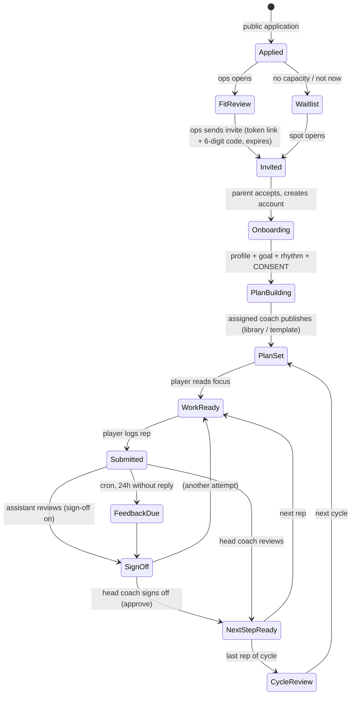

# Baller Connection v3

**One focus. One next rep. A coach who answers.**

Keith Witter's virtual player-development program, rebuilt as a multi-user product: real accounts, roles and permissions, an invite + consent flow, staff routing, notifications, a scheduled SLA job and a normalized D1 database. Every role sees the **same lifecycle state in the same words**, and every state answers five questions: *what's happening, why it matters, who acts next, by when, and what it unlocks.*

- **Live demo (GitHub Pages):** https://keithalanwitter-design.github.io/baller-connection/ This build runs the same engine in your browser on fictional data. The demo bar switches between **Player · Parent · Head coach · Assistant · Ops**.
- **Real product:** the same app served by a Cloudflare Worker with D1, sessions and cron. See **[DEPLOY.md](DEPLOY.md)**.

## Roles
| Role | Lands on | Owns |
|---|---|---|
| **Head coach** (owner) | Action Center | Their players' plans and reviews, **sign-off** on assistant reviews, settings, staff, team view |
| **Assistant coach** | Action Center (own players only) | Plans, reviews, messages and digests for **assigned** players. Reviews can require head-coach sign-off |
| **Ops staff** | Ops queue | Intake, fit calls, invites, billing status (unpaid/paid/comp), coach assignment, scheduling, capacity/waitlist, privacy requests. **No coaching judgment**: no canvas, rubric, messages or reviews |
| **Parent / guardian** | Parent view | Owns the player account: accepts the invite, records consent, sets the player's username + PIN, messages, pause/resume, CSV export, deletion request |
| **Player** | Today | Unlock reps, log practice (+ optional link), habits, messages. Players under 13 sign in with a parent-issued **username + PIN** (no email) |

The permission matrix lives in [`shared/permissions.ts`](shared/permissions.ts) (`COMMAND_ROLES`, `ENDPOINT_ROLES`, `scopeSnapshot`). The server enforces it on every endpoint, and `tests/permissions.test.ts` checks every role × command and every role × endpoint, both allow and deny.

## One workflow for everyone

- **One engine.** `shared/engine.ts` `dispatch(snapshot, command, actor)` is the only way state changes. It checks permissions, guards transitions, writes events (the audit log), notifications and outbox email. The browser demo and the Worker run the same module.
- **One guide.** `shared/workflow.ts` `guide()` produces what / why / who / by-when / unlocks for the player, parent, coach and ops views from the same state.
- **Routed queues.** `buildQueue(s, ownerId)` routes each item to the player's assigned coach (sign-offs go to the head coach). `buildOpsQueue` covers new applications, fit calls to book, invites pending/expired, payment, data requests and the waitlist. `teamLoad` powers the Team view. Every row shows what / why / owner / due / unlocks, and the counts come from the same list as the rows.
- **Notifications.** An in-app inbox per user for: reply due soon, overdue, new submission, feedback ready, invite accepted, plan published, cycle review (plus sign-off needed, new application, invite expired, new message, digest ready). The scheduler emails unread items as a digest through the email provider.
- **Scheduled jobs** (Worker cron, `wrangler.toml`): every 15 min the job runs the SLA/overdue sweep, invite expiry and notification email digest. Sunday 23:00 UTC it generates the weekly parent digest drafts. Nothing is computed at read time.

## Product details
Drill library (create, edit, archive, reuse) · plan templates · calendar of check-ins, live sessions and fit calls with a signed **iCal** feed · threaded messages per player with **read receipts** · **link attachments only** (no uploads, no game-film review; the copy says so) · settings for availability, SLA per tier, capacity caps, Inner Circle cap, sign-off rule, invite expiry and branding · audit log · per-player **CSV export** · deletion request → ops completes → player data removed · dev **Outbox** page.

## Architecture
```
shared/  domain.ts (types, Command union) · engine.ts (dispatch) · workflow.ts (state machine, guide, queues) · permissions.ts · seed.ts
server/  app.ts (HTTP handler: auth, endpoints, cron) · repo.ts (row-level diff writes + targeted queries) · schema.ts (column map)
         auth.ts (PBKDF2 hashes, HMAC session tokens, cookies) · email.ts (Log | Resend | Postmark) · export.ts (CSV, iCal)
         worker.ts (Cloudflare entry: fetch + scheduled + static assets) · node.ts + sqljs.ts (same handler on Node + SQLite for local dev/tests)
         migrations/0001_init.sql · 0002_auth.sql · 0003_rate_limits.sql   (incremental, tracked in d1_migrations)
src/     React + Vite. api.ts: DemoApi (in-browser engine, demo only) | HttpApi (live, cookies). Pages: Coach.tsx (coach + ops shell), Auth.tsx, Welcome.tsx, Player.tsx, Parent.tsx, Inbox.tsx, Log.tsx
```
**Schema.** 21 normalized tables with foreign keys (`DEFERRABLE INITIALLY DEFERRED`, `ON DELETE CASCADE` from players) and indexes on every lookup column: families, users, players, applications, invites, consents, cycles, drills, templates, assignments, submissions, reviews, messages, habits, milestones, digests, meetings, notifications, outbox, data_requests, events. Also settings/meta (key-value), credentials (password/PIN hashes), auth_sessions (HMAC'd token hashes), password_tokens and login_attempts. A write only upserts the rows that changed and deletes removed rows, in one atomic D1 batch.

**Auth.** Email + password for parents and staff. Username + PIN for players. PBKDF2-SHA256 (100k iterations). The session token lives only in an `HttpOnly; SameSite=Lax; Secure` cookie, and the DB stores `HMAC(SESSION_SECRET, token)`. Login is throttled to 5 failures per 15 min. Staff and owners set passwords from an emailed link. The provider is pluggable: swap `/api/auth/*` for an IdP and keep `Actor`.

## API (all JSON; cookie session)
`POST /api/auth/login | logout | accept-invite | player-login | request-password | reset-password` · `GET /api/auth/me` · `POST /api/apply` (public) · `GET /api/snapshot` (role-scoped) · `POST /api/commands` (any `Command`, permission-checked) · `GET /api/queue | team | audit | outbox | notifications | calendar-link` · `GET /api/players/:id/export.csv` · `GET /api/calendar/:user/:sig.ics` · `POST /api/staff` · demo only (`DEMO=1`): `POST /api/demo/reset | sweep`.

## Run locally
```bash
npm install
npm test                      # 170 Vitest checks: engine, permissions matrix, invites/consent, routing, cron, notifications, API flow
npm run dev                   # demo build (in-browser engine)
npm run serve:local           # live build + Node/SQLite API on http://localhost:8787/baller-connection/
# or the real Worker runtime with local D1 (Node 22+):
npm run build:worker && npx wrangler d1 migrations apply baller-connection --local && npx wrangler dev --local --test-scheduled
node tests/e2e-multi.mjs      # BASE=http://localhost:8799/baller-connection/ (or :8787 / wrangler's :8787/)
node tests/e2e.mjs            # demo-mode e2e (BASE=Pages URL or vite preview)
```
Local demo accounts (seeded only when `SEED=demo`): `head@demo.test`, `assistant@demo.test`, `ops@demo.test`, `dana@demo.test` (parent), password `demo-pass-123`. Players `avery.pine`, `sam.quill`, `nia.fable` use PIN `1234`.

## Pricing
| Plan | Price | Default reply window | Includes |
|---|---|---|---|
| Foundation | $69/mo | 2 business days | One focus, weekly reps, 1 review/week, habits and levels, parent summary |
| Development | $139/mo | 1 business day | + up to 3 reviews/week, plan adjusted every 2 weeks, monthly 20-min video check-in |
| Inner Circle | $229/mo (cap in settings) | Same business day | + weekly 30-min live session, review on every submission, pre-tournament plan |

Reply windows and caps can be edited in Settings. Billing status is tracked by hand (unpaid/paid/comp) until Stripe is connected.
