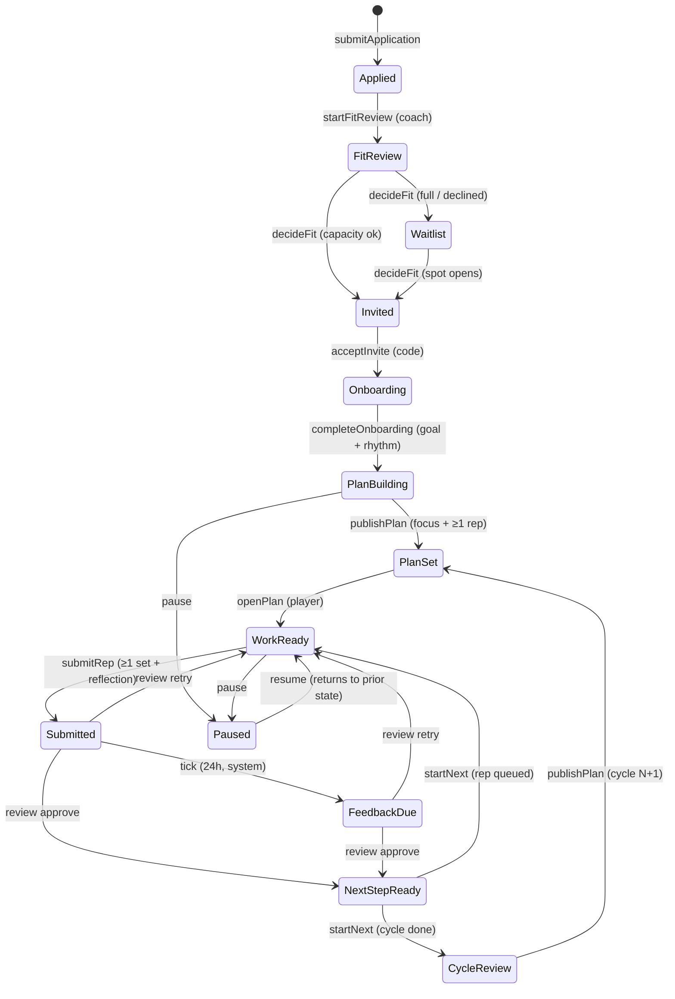

# Baller Connection v2

**One focus. One next rep. A coach who answers.**

Keith Witter's branded alternative to Baller Path. It's a virtual player-development program built on a real workflow engine. The family, the player and the coach all see the same lifecycle state, worded for their role. Every state answers five questions: *what's happening, why it matters, who acts next, by when, and what it unlocks.*

**Live demo:** https://keithalanwitter-design.github.io/baller-connection/ (fictional players only)

The top bar switches between **Visitor**, **Family** and **Coach**. **⏩ +1 day** moves the demo clock forward so you can watch reply deadlines escalate. **System log** shows every event. **Reset demo** restores the seed data.

## What's new in v2
- **Brand:** an orange (#FF5E1A) and court-blue (#0A1430 / #12296B) system with sun (#FFC53D) and sky (#3FD0FF) accents. Headings use Barlow Condensed and body text uses Inter. The design has hardwood and court-line motifs and an animated half-court hero that shows the weekly loop.
- **Engagement:**
  - A journey map with 5 levels and explicit unlock criteria.
  - Streaks with a 7-day strip.
  - Bouncing rep taps.
  - Level-up and approval celebrations.
  - A "What's next" sheet after every action.
  - All motion is disabled under `prefers-reduced-motion`.
- **Workflow engine:** an explicit state machine with guards, reply-by deadlines (SLAs) with overdue escalation, capacity limits, and an event log shared by the browser and the API server.
- **Backend:** a Cloudflare Worker with D1 (SQLite), REST endpoints and migrations. A Node + SQLite (WASM) dev server runs the same code.

## Architecture
```
shared/            ← one source of truth, imported by the browser, the server and the tests
  domain.ts        entities, lifecycle states, tiers/SLAs, Command union
  workflow.ts      TRANSITIONS table + guards, guide() (what/why/who/when/unlocks), coach queue, capacity, levels
  engine.ts        dispatch(snapshot, command) → { snapshot, events }  (pure; throws WorkflowError on a failed guard)
  seed.ts          fictional demo data (Avery Pine, Riley Moss, Sam Quill, Nia Fable, Theo Banks)
  api.ts           BallerApi interface (typed service layer)
src/               React + Vite UI
  api.ts           LocalApi (in-browser engine + localStorage) and HttpApi (REST)
server/
  app.ts           REST router: handle(Request, Db) → Response   (shared by Worker and Node)
  repo.ts          Repository: Snapshot ⇄ tables; batched, change-only writes
  worker.ts        Cloudflare Worker entry (env.DB = D1)
  node.ts, sqljs.ts  local Node server over sql.js with a D1-compatible adapter
  migrations/0001_init.sql
tests/             vitest unit + API tests, Playwright e2e
```
**Entities:** coach, family, player, application, invite, cycle (plan + focus), assignment, submission (rep log), review, message, habit, milestone, digest and event (audit log).

### Lifecycle state machine

`FitReview` = "Fit review", `PlanBuilding` = "Plan building", and so on. `pause` is allowed from any active state, and `resume` returns to exactly the state the family paused from.

**Reply-by SLAs:** Foundation gets 2 business days, Development 1, and Inner Circle the same business day. Weekends don't count, and a reply is due by 6 PM on the due day. **Capacity:** 15 on the roster and 4 in Inner Circle. The engine waitlists any invite past either cap.

**Coach queue:** one ranked list: Reply needed → Work ready → Plan needed → Activation → Upcoming. Overdue items go first. The counts come from the same rows, which the tests check.

## API
| Method | Path | Purpose |
|---|---|---|
| GET | `/api/health` | `{ ok, version }` |
| GET | `/api/snapshot` | full aggregate (runs `tick` first so SLAs are current) |
| GET | `/api/queue` | ranked coach queue + counts + capacity |
| GET | `/api/players/:id` | player record |
| GET | `/api/players/:id/guide?role=player\|parent\|coach` | what / why / who / by when / unlocks + journey progress |
| GET | `/api/events?limit=100` | audit log |
| GET | `/api/workflow` | transitions table |
| POST | `/api/commands` | body = a `Command` (e.g. `{"type":"submitRep","playerId":"avery","repsDone":4,"reflection":"…"}`) → `{ snapshot, events }`; **409** with `{ error }` when a guard fails |
| POST | `/api/reset` | reseed demo data |

To point the UI at an API, open the site with `?api=https://<worker-url>` (it's remembered in localStorage) or build with `VITE_API_URL`. Use `?api=local` to switch back to the in-browser engine.

## Run locally
```
npm install
npm run dev            # UI on the in-browser engine
npm run api            # REST API on http://localhost:8787 (SQLite file server/local.sqlite)
npm run typecheck && npm run lint && npm test     # tsc, oxlint, vitest (engine + API)
npm run build && npx vite preview --port 4180 &
CHROME=<path to chromium> npm run test:e2e        # Playwright e2e across every role; writes shots/
```

## Deploy the backend (Cloudflare)
No Cloudflare credentials were available on the build machine, so the Worker isn't deployed yet. The live site runs the same engine in the browser. To deploy:
```
npm i -D wrangler && npx wrangler login
npx wrangler d1 create baller-connection          # paste database_id into wrangler.toml
npx wrangler d1 migrations apply baller-connection --remote
npx wrangler deploy                               # → https://baller-connection-api.<account>.workers.dev
```
Then open `https://keithalanwitter-design.github.io/baller-connection/?api=https://baller-connection-api.<account>.workers.dev`. You can also set the `VITE_API_URL` repo variable and add `env: VITE_API_URL: ${{ vars.VITE_API_URL }}` to the build step. `ALLOW_ORIGIN` in `wrangler.toml` limits CORS to the Pages origin.

## Pricing
| Plan | Price | Reply window | Includes |
|---|---|---|---|
| Foundation | $69/mo | 2 business days | Plan with one focus, weekly reps, 1 review/week, habits and levels, parent summary |
| Development | $139/mo | 1 business day | + up to 3 reviews/week, plan adjusted every 2 weeks, monthly 20-min video check-in |
| Inner Circle | $229/mo (4 spots) | Same business day | + weekly 30-min live session, review on every submission, pre-tournament plan |

## Demo vs. production
The demo has no authentication: role switching is open, and the API trusts its callers. Production would need:
- Real auth with family, player and coach accounts.
- Invite emails.
- Stripe billing.
- Notifications on reply deadlines.
- Uploads.
- Parental-consent records (COPPA for players under 13).
- Per-entity writes instead of whole-table rewrites in `repo.ts`.
- Scheduled `tick` jobs, which the Worker could run as a cron trigger.
